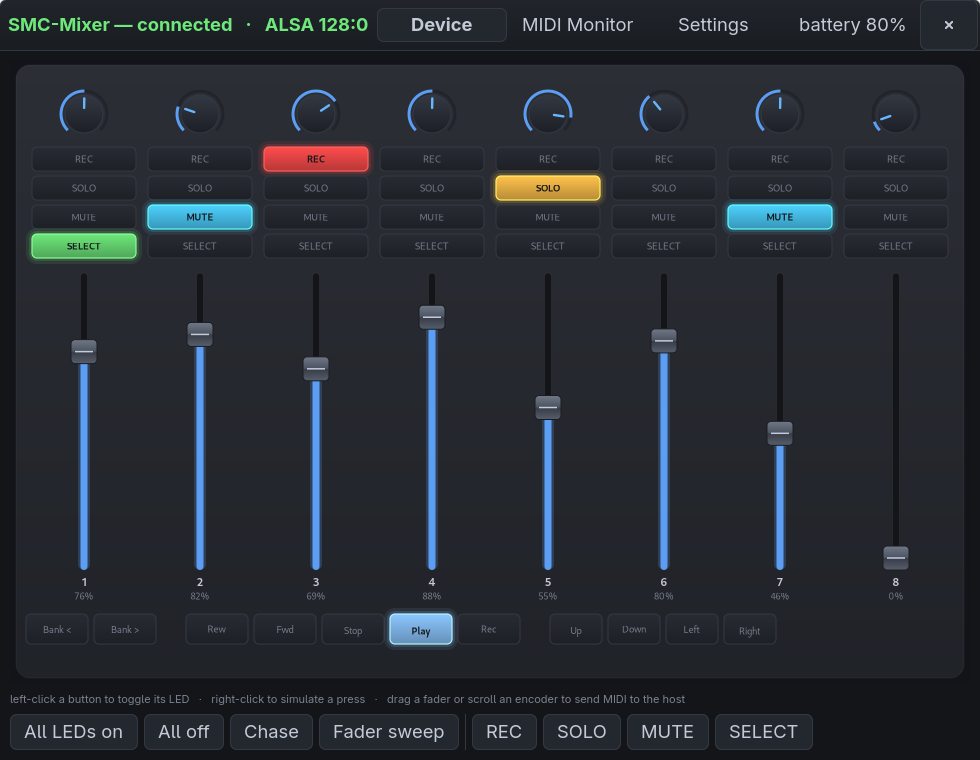
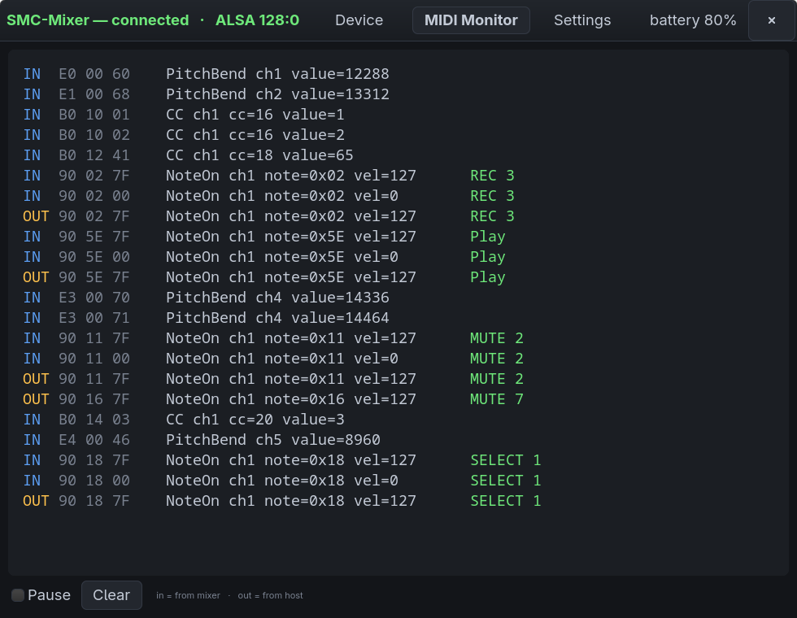

# SMC-Mixer on Linux

Bridges the Bluetooth **M-VAVE SMC-Mixer** (an 8-fader, 8-encoder Mackie
Control style BLE-MIDI control surface) onto the ALSA sequencer, so REAPER,
Ardour, Bitwig and anything else that speaks MIDI can use it as a normal
control surface — plus a GTK4 panel for
live preview, manual testing and configuration.



## Why this exists

The mixer is a standards-compliant BLE-MIDI device, but some distributions
(Fedora among them) build BlueZ without the MIDI plugin. So it pairs and connects happily and then **never
appears in `aconnect -l` or `amidi -l`**. Nothing is broken; there is simply no
component turning GATT notifications into a sequencer port. That is what
`smcmixerd` does, talking to the BLE-MIDI characteristic over the BlueZ D-Bus
API and exposing an ALSA sequencer client built directly on `libasound`.

No third-party Python packages are used — `python3-dbus` and `python3-gobject`
ship with the system, and the ALSA binding is `ctypes`.

## Architecture

```
mixer  --BLE-->  smcmixerd  --ALSA seq-->  REAPER / PipeWire
mixer  <--BLE--  smcmixerd  <--ALSA seq--  LED feedback from the host
                     |
                     +--unix socket-->  ui.py  (preview, tests, settings)
```

The daemon is the long-lived half. It owns the Bluetooth link, the MIDI port
and the device state; the UI is just a client. **Closing the window does not
touch the bridge** — the DAW's port stays exactly where it was.

## Requirements

- Linux with BlueZ (`bluetoothd`) and ALSA (`libasound.so.2`)
- Python 3 with `dbus-python` and PyGObject (GTK 4) — on Fedora these are
  `python3-dbus` and `python3-gobject` plus `gtk4`
- `systemd --user` (the daemon launches the UI as a transient user unit)
- The mixer paired and trusted once with `bluetoothctl` or GNOME Settings

No third-party Python packages are needed.

## Install

Clone anywhere, then install the user service and launcher, substituting the
clone's absolute path for `@INSTALL_DIR@`:

```bash
git clone https://github.com/Bulrok/smc-mixer-linux.git ~/smc-mixer-linux && cd ~/smc-mixer-linux
mkdir -p ~/.config/systemd/user ~/.local/share/applications \
         ~/.local/share/icons/hicolor/scalable/apps
sed "s|@INSTALL_DIR@|$PWD|" contrib/smc-mixer.service > ~/.config/systemd/user/smc-mixer.service
sed "s|@INSTALL_DIR@|$PWD|" contrib/smc-mixer.desktop > ~/.local/share/applications/smc-mixer.desktop
cp smc-mixer.svg ~/.local/share/icons/hicolor/scalable/apps/
systemctl --user daemon-reload
systemctl --user enable --now smc-mixer
```

| Thing | Path |
|---|---|
| Bridge service | `~/.config/systemd/user/smc-mixer.service` |
| App launcher | `~/.local/share/applications/smc-mixer.desktop` |
| Config | `~/.config/smc-mixer/config.json` (created on first save) |
| Socket | `$XDG_RUNTIME_DIR/smc-mixer.sock` |

```bash
systemctl --user status smc-mixer     # bridge state
journalctl --user -u smc-mixer -f     # live log
```

Then connect `SMC-Mixer MIDI` to your DAW (or `aconnect`) as a Mackie Control
surface.

The UI opens automatically when the mixer connects, and appears in the desktop
app finder as **SMC-Mixer**. It runs as its own transient unit
(`smc-mixer-ui.service`), so restarting the bridge never disturbs the window
and vice versa.

## Using the panel

| Action | Effect |
|---|---|
| Left-click a button | Toggles that LED on the hardware |
| Right-click a button | Simulates a press — sends MIDI to the host, LED untouched |
| Drag a fader | Sends fader MIDI to the host |
| Scroll an encoder | Sends relative encoder ticks to the host |

The window is **dark unconditionally** — it forces
`gtk-application-prefer-dark-theme` and ships its own stylesheet rather than
following the desktop preference, because the device art is painted dark and
light chrome around it looks like a rendering fault. The GTK palette in `CSS`
and the Cairo constants at the top of `ui.py` are the same colours, so the
chrome and the device read as one surface; change them together.

The test row runs whole-panel checks: all LEDs on/off, a chase across every
light, a fader sweep, and per-row lighting. The **MIDI Monitor** tab shows both
directions with decoded names; `in` is from the mixer, `out` is from the host.



`selftest.py` does the same round-trip from the command line, subscribing to
the bridge as a stand-in DAW.

## Settings

- **Open this window when the mixer connects** — auto-launch. The bridge runs
  regardless.
- **Reconnect the mixer automatically** — asks BlueZ to re-establish the link
  when the mixer wakes up. A watchdog also re-attaches after sleep or range
  loss.
- **Light LEDs locally on button press** — lets buttons toggle their own lights
  with no DAW attached. Off by default, because a real MCU host owns the LEDs.

## The device has two mapping modes — check this first

The mixer can be switched, by a button combo on the unit, into a **CC-only
mode** where every control sends Control Change instead of the Mackie
messages. Observed side by side:

| Control | Mackie mode | CC-only mode |
|---|---|---|
| Fader | PitchBend ch1–8 | CC 40 |
| REC 5 | NoteOn `0x04` | CC 20 |
| SOLO 5 | NoteOn `0x0C` | CC 28 |
| MUTE 5 | NoteOn `0x14` | CC 36 |
| SELECT 5 | NoteOn `0x1C` | CC 44 |

In CC mode nothing matches `layout.py`, so **the preview freezes and LEDs stop
responding while the MIDI monitor keeps scrolling** — which reads as a broken
app rather than a mis-set device.

The bridge now detects it: if under 25% of a 40-message window maps to the
Mackie layout, the panel shows an amber banner saying the mixer is probably in
CC mode, and the daemon logs the same to the journal. It clears itself as soon
as recognisable traffic returns. `test_mode.py` covers both directions.

If you see that banner, use the button combo on the mixer to return it to
Mackie/MCU mode.

## Tests

```bash
python3 test_decode.py   # BLE-MIDI packet codec, against real captured packets
python3 test_mode.py     # wrong-mode detection, both directions
python3 selftest.py      # end-to-end, needs the bridge running and the mixer connected
```

## Troubleshooting

**The window shows traffic in the monitor but the device preview is frozen.**
Almost certainly more than one UI process. `ui.py` is a `Gtk.Application` with a
fixed application id, so a second launch hands off to the first and exits — you
can end up looking at an older window than you think. Check with:

```bash
pgrep -af 'python.*ui\.py'          # should be exactly one
busctl --user list | grep SmcMixer  # should be exactly one owner
systemctl --user restart smc-mixer  # cleanest reset; relaunches the UI
```

Note `pgrep -f 'smc-mixer/ui.py'` will miss an instance started as
`python3 ui.py` from inside the directory — match on `ui\.py` instead.

The header bar states the bridge link explicitly: **"bridge offline —
reconnecting…"** means the window is not talking to the daemon, as distinct
from the mixer itself being disconnected. The client also pings every 2s so a
half-dead socket reconnects rather than going quietly deaf.

Run the UI with `SMC_DEBUG=1` to trace draws, incoming events and clicks to
stderr:

```bash
SMC_DEBUG=1 python3 ui.py
```

## Protocol

Plain Mackie Control, surveyed from the hardware rather than assumed
(`survey.py` records it; `survey.json` is the raw survey of one unit;
`layout.py` is the resulting map).

| Control | MIDI |
|---|---|
| 8 faders | PitchBend on channels 1–8. 14-bit on the wire, but the LSB is always 0 — 128 real steps, full scale 16256 |
| 8 encoders | CC 16–23 on ch1, relative: `0x01`–`0x3F` = n ticks CW, `0x41`–`0x7F` = n ticks CCW. No LED rings |
| Channel buttons | NoteOn ch1 — REC `0x00`–`0x07`, SOLO `0x08`–`0x0F`, MUTE `0x10`–`0x17`, SELECT `0x18`–`0x1F` |
| Bank | NoteOn ch1 `0x2E` / `0x2F` |
| Transport | NoteOn ch1 `0x5B`–`0x5F` (rew, fwd, stop, play, rec) |
| Nav | NoteOn ch1 `0x60`–`0x63` (up, down, left, right) |

LEDs are lit by sending the button's own note back with velocity 127, and
cleared with velocity 0. There is **no readback** — the daemon's LED model is
what it last sent, which is why the UI and the host must go through it.

BLE writes are batched: messages queued within 12 ms are packed into one
BLE-MIDI packet up to the negotiated MTU, so a 32-LED chase is one write rather
than 32.

## Notes

- Battery is exposed by BlueZ and shown in the header bar.
- The bridge autodetects a BLE-MIDI device by service UUID whose name contains
  `name_filter` (default `mixer`, so an SMC-PAD paired on the same machine is
  not picked up by mistake). Pin a specific unit by setting `address`
  (e.g. `"AA:BB:CC:DD:EE:FF"`) in `~/.config/smc-mixer/config.json`.

## Status and limitations

- Tested with one SMC-Mixer in Mackie mode, on Fedora with PipeWire.
- Encoders have no LED rings and the device has no LED readback, so LED state
  is whatever the bridge last sent.
- No display / timecode / meters — the hardware has none.
- CC-only mode is detected and flagged, not translated.

## Disclaimer

This is an independent project, not affiliated with or endorsed by M-VAVE.
All trademarks belong to their respective owners.

## License

GPL-3.0-or-later — see `LICENSE`.
